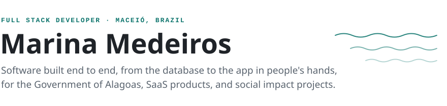
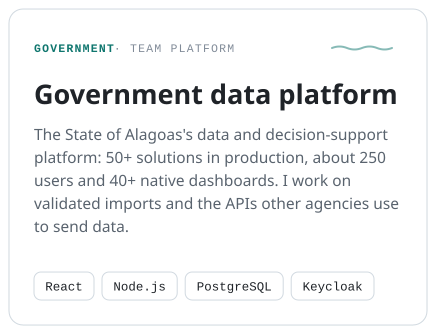
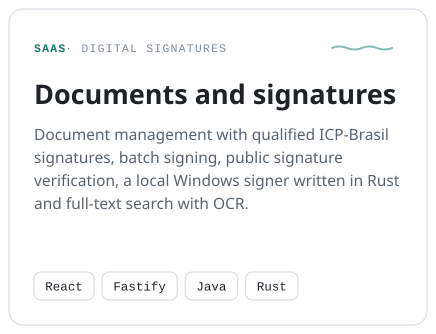
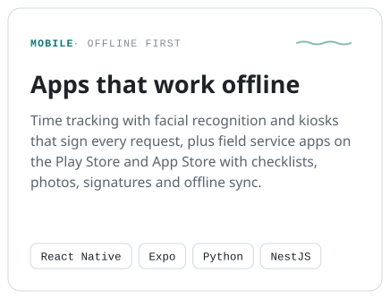
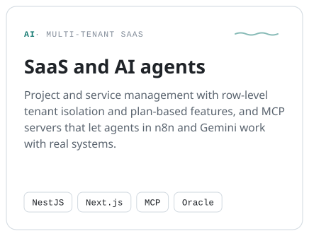
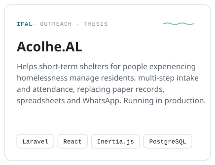
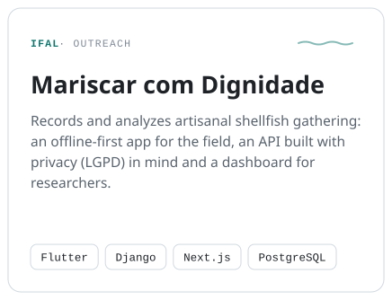
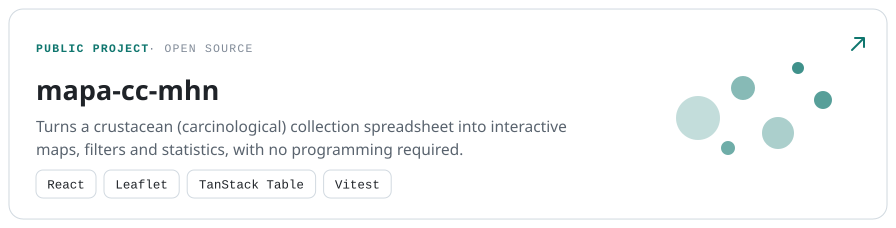

<picture>
  <source media="(prefers-color-scheme: dark)" srcset="./assets/header-dark.svg">
  
</picture>

<a href="https://www.linkedin.com/in/marina-paffer/" title="LinkedIn"><picture><source media="(prefers-color-scheme: dark)" srcset="./assets/link-linkedin-dark.svg"></picture></a>
<a href="mailto:marinapaffer@gmail.com" title="Email"><picture><source media="(prefers-color-scheme: dark)" srcset="./assets/link-email-dark.svg"></picture></a>

Hi, I'm Marina. I like owning the whole path of a feature: the data model, the API, and the screen someone uses out in the field
on a weak signal. Today I'm part of the team behind the data platform the State of Alagoas uses
to follow its programs and investments, and at F2J Soluções I build SaaS products with digital signatures,
offline-first apps, and integrations that let AI agents work with real systems. I'm also finishing my Information
Systems degree at IFAL, with a thesis that grew out of a shelter management system I built in a community
outreach project.

### How I work

- **Offline first** when the field demands it: durable queues, idempotent sync, nothing lost when the signal drops.
- **Integrations designed for the people on the other end**: clear errors, deduplication and guides for the teams that send data.
- **Security by default**: single sign-on, tenant isolation, signed requests and privacy by design (LGPD, Brazil's GDPR) from the first table.
- **AI where it helps**: MCP servers that let agents work with real systems.
- **Shipping safely**: Docker, tests before every deploy, blue-green releases and Kubernetes.

<h3>Selected work</h3>

 

<picture><source media="(prefers-color-scheme: dark)" srcset="./assets/card-gov-dark.svg"></picture>
<picture><source media="(prefers-color-scheme: dark)" srcset="./assets/card-docs-dark.svg"></picture>
<picture><source media="(prefers-color-scheme: dark)" srcset="./assets/card-offline-dark.svg"></picture>
<picture><source media="(prefers-color-scheme: dark)" srcset="./assets/card-ai-dark.svg"></picture>
<picture><source media="(prefers-color-scheme: dark)" srcset="./assets/card-acolhe-dark.svg"></picture>
<picture><source media="(prefers-color-scheme: dark)" srcset="./assets/card-mariscar-dark.svg"></picture>
<a href="https://github.com/marinamedeirosz/mapa-cc-mhn"><picture><source media="(prefers-color-scheme: dark)" srcset="./assets/project-mapa-cc-mhn-dark.svg"></picture></a>

<b>More on this work</b>

 

**Government data platform** · Secretariat of Corporate Governance of the State of Alagoas, since 2026, as part of the team.

- Forms, spreadsheet imports reviewed before saving, validation queues, georeferenced maps, and PDF, Word and Excel reports.
- Integration APIs for other state agencies on a durable PostgreSQL queue, with deduplication, masking of personal IDs (CPF) in logs, batch tracking and integration guides. One batch load went from 106 s to 1 s.
- An internal agile management system with kanban, sprints, a productivity dashboard and an MCP server for AI agents.
- Single sign-on with Keycloak and OIDC, a k3s cluster with sandbox and production, and a state data catalog validated in CI.

**Documents and signatures** · F2J Soluções. Java signing service (PDFBox, Bouncy Castle), batch signing, public signature verification with a PDF report, a local Windows signer in Rust with a browser extension and JWS ES256 authorization, full-text search in PostgreSQL with OCR, and a citizen portal.

**Apps that work offline** · F2J Soluções. An offline-first time tracking app with an encrypted contingency queue and idempotent sync, a facial recognition service with hexagonal architecture, kiosks with hardware-backed keys and HTTP message signatures (RFC 9421), and field service apps with branching checklists, geolocation and offline media.

**SaaS and AI agents** · F2J Soluções. Tenant isolation through PostgreSQL row-level security, plan-based features, scoped integration tokens, an MCP server with more than 100 tools, hour tracking with overlap detection, a Next.js site with self-service checkout and an AI pre-sales chat, finance, CRM and HR systems on Oracle, and a WhatsApp sales agent powered by an LLM.

**Mariscar com Dignidade** · Flutter app with local storage (Hive), a durable outbox, background sync and a minimum version policy, and a Django API with idempotent writes, access auditing, consent records and in-app account deletion.

<h3>Technologies</h3>

#### Languages

#### Frontend

#### Backend

#### Mobile

#### Data

#### Infrastructure

#### Identity and security

#### AI and automation

 

Information Systems at IFAL · English: proficient · the images on this page are SVGs built by <a href="./scripts/build_assets.py">one script</a>.

  

<picture>
  <source media="(prefers-color-scheme: dark)" srcset="https://raw.githubusercontent.com/marinamedeirosz/marinamedeirosz/output/github-contribution-grid-snake-dark.svg">
  <source media="(prefers-color-scheme: light)" srcset="https://raw.githubusercontent.com/marinamedeirosz/marinamedeirosz/output/github-contribution-grid-snake.svg">
  
</picture>
